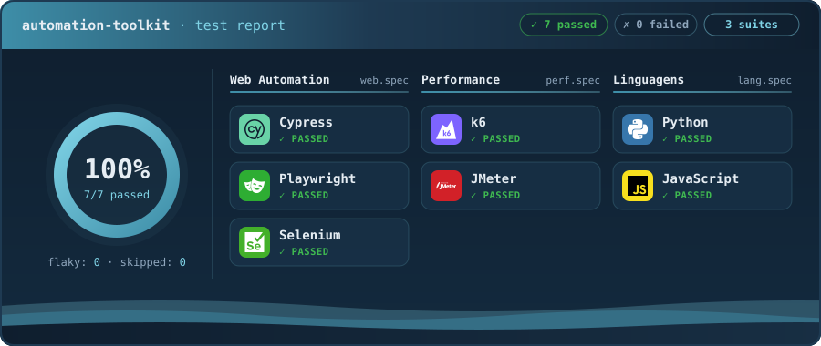

<div align="center">


<a href="https://github.com/Borboletas-Edu">
  
</a>

</div>

<br/>

## 🧪 Sobre mim

```gherkin
# language: pt
Funcionalidade: Conhecer o Edu

  Cenário: Visitante abre o perfil
    Dado que eu sou um profissional de Qualidade de Software
    E automatizo testes com Cypress, Playwright e Selenium
    Quando eu estruturo projetos em Page Objects, Flows e Data
    Então os testes ficam eficientes, reutilizáveis e sustentáveis
    E eu sigo evoluindo rumo a Software Development Engineer in Test
```

Olá! Eu sou o **Edu**, profissional de **Qualidade de Software** com grande interesse em automação de testes e desenvolvimento.

Para mim, qualidade vai além de validar funcionalidades: está em construir **estruturas de testes eficientes, reutilizáveis e sustentáveis**.

Tenho experiência prática com **Cypress, Playwright e Selenium** em projetos reais, aplicando diferentes abordagens de automação e arquiteturas em camadas, como **Page Objects, Flows e Data**, sempre buscando mais organização, escalabilidade e facilidade de manutenção.

Estou constantemente explorando novas tecnologias, ferramentas e estratégias de testes, aprimorando não só a execução das automações, mas também a forma como elas são **planejadas, estruturadas e integradas** ao desenvolvimento de software.

> 🎯 **Objetivo:** evoluir continuamente em engenharia de testes e automação, rumo a **Software Development Engineer in Test (SDET)**.

<br/>


## 🖥️ Automation Toolkit

<div align="center">
  
</div>

<br/>

## 📈 Test Report

```diff
  Perfil: Edu
+ ✔ curiosidade técnica ........................ passed
+ ✔ automação em camadas ....................... passed
+ ✔ foco em manutenção e escalabilidade ......... passed
+ ✔ aprendizado contínuo ........................ passed
! ◌ SDET ........................................ in progress
```

<br/>


